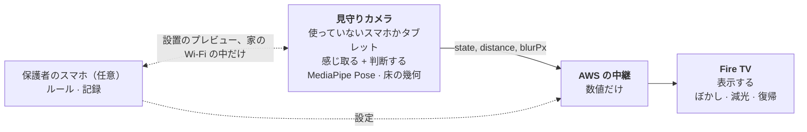
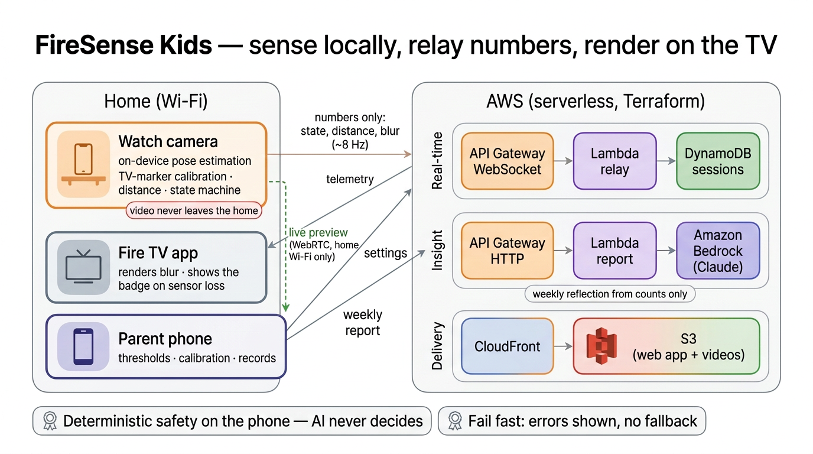
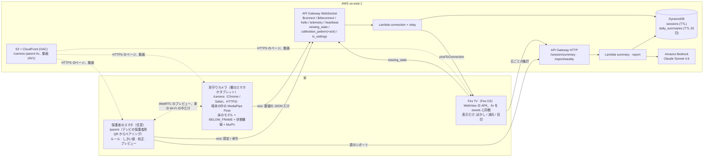

# 🐾 FireSense Kids — Fire TV のための「体を理解する」視聴

> **見ている人がどれだけ近いかに反応する Fire TV の体験。**
> **ジェスチャーも、コマンドもいらない。ただ見るだけ。**


*実機の Fire TV Stick 4K Max でノーカット（[デモ動画](https://youtu.be/-O-m-KmxTes)から）。左は部屋を撮るスマホ、右は同じ瞬間の見守りカメラの画面で、測った距離が出ている。マスコットのカードは保護者が選ぶ設定で、既定ではオフ。*

**Amazon Developer Hackathon 2026** のために作った作品です（トラック: **Fire TV**／ミニチャレンジ: **AWS Builder**、**Open Source**（[visual-thinker](https://github.com/marcosanyo/visual-thinker)））。

**デモ動画（3分未満）:** https://youtu.be/-O-m-KmxTes

English: [README.md](README.md)（英語版が正で、食い違ったら英語版が正しい）

## 3つの考え

**1. テレビが、見ている人に反応する。** テレビに近づくと映像が少し見えにくくなり、もっと近づくと強くぼけて暗くなり、下がれば自然に元に戻ります。覚えることも、押すものもありません。ジェスチャーや声のコマンドは、わざと用意していません。映像をくっきりに戻せるのは、ルールが求めていること、つまり下がることだけです。ジェスチャーがあると、子どもは近くにいたまま映像を戻せてしまいますし、まずそれを覚えなければなりません。反応は子どもの立っている位置に比例していて、線を越えたときにだけ出る警告ではありません。

**2. テレビそのものが物差しになる。** Fire TV にはカメラがないので、棚に置いた使っていないスマホかタブレットが部屋を見守ります。校正のとき、テレビは画面を黒、次にマゼンタにします。スマホは画面の四隅を見つけ、画面の大きさが分かっていることと、スマホの傾きセンサーで自分の傾きの角度が分かることから、自分がどこにいるかを解き、テレビの前の床の地図を作ります。床の目印も、カメラの内部パラメータのデータベースも、画像のアップロードもいりません。実際のリビングで、距離の誤差の中央値は **10cm**（0.8〜1.4m）、保護者がメジャーで2点を合わせると **3cm**（合わせるのに使わなかった距離では 2cm、最大 8cm）です。

**3. 家の中で感じ取り、数値だけを中継し、テレビで表示する。** 見守りカメラが姿勢推定とすべての判断を端末の中で行います。AWS は数値を中継し、日ごとの回数を記録します。Fire TV は表示するだけです。



- **子どもの映像は家から出ません。** クラウドに届くのは数値だけです。
- **リアルタイムの介入の経路に AI はありません。** 距離 → ぼかし → 復帰は決定論的です。Bedrock の Claude は、回数から保護者向けの週の振り返りを書くだけです。
- **センサーが壊れたら、くっきりした再生に戻ります。** 壊れた・閉じたセンサーのせいで映像がぼけたままになることはありません。

**検証。** デモ動画は、実機の Fire TV Stick 4K Max と大人の視聴者で、体験のひと通りを、切らずに2台の機器で同時に見せます。距離の数字は、メジャーで測った印に大人が立ち、見守りスマホを部屋の奥の隅に置いて測ったものです。計測の道具はアプリに組み込んであります（[`MEASUREMENT_EVIDENCE.md`](docs/proof/MEASUREMENT_EVIDENCE.md)）。

**小さな子ども。** 部屋の向こうに置いた実機のスマホで、既定のモデル（MediaPipe Pose）は手元の1歳4か月の子どもを見つけます。動画の「検出のテスト」の骨格は MediaPipe です。いちばんよく追えるのは子どもがカメラの方を向いているときで、後ろや横を向くと見失うことが増えます。画面全体の推論だけでは小さな子どもを見落としていたので、見守りカメラは拡大した2回目の推論を行います（誰も見つかっていない間は4倍のタイルで走査し、見つかったらその人を切り抜いて追う）。小さく映る子どもや遠くの子どものためには、任意の **高精度** モデル（RTMO）のほうが多く見つけます。ただし WebGPU が正しく動く端末に限ります（数値は §3）。この体験は、近づくとアニメが見えにくくなることに気づける、未就学〜小学校低学年の子どもを想定して設計しました。1歳4か月ではまだ映像と自分の立つ位置を結びつけないので、手元の子どもは検出のテストにだけ出てもらい、数日間の家庭での検証（[`FIELD_PILOT.md`](docs/proof/FIELD_PILOT.md)）はその年齢層で行う次のステップとしています。

FireSense Kids は、家族での視聴のためにこのインタラクションを探るものです。保護者が決めたルールを、親が繰り返し叱らなくてもテレビが守らせるように設計しました。どこからが近すぎるか、テレビがどれだけ強く反応するかは保護者が決めます。視力や健康についての主張はしません。

---

## 5分で試す

**審査員の方へ:** 私たちがホストしているテレビの画面（AWS us-east-1）は Devpost の **Project Testing Link** にあり、投稿に添付した `firesense-kids-judges.zip` に APK とすべての URL があります。**それ以外の方は:** `make deploy`（§8）で自分のスタックを作ってください。下の URL は、その Terraform の出力です（`terraform -chdir=infra/terraform output -raw tv_url` などで取り出せます）。

### 機器なしで（パソコンだけ。スマホは任意）

1. **テレビの画面を開く**: デスクトップのブラウザ（Chrome、Edge、Safari）で、出力 **`tv_url`**（`https://<cloudfront_url>/tv/`）を開きます。アニメが始まらなければ、ページのどこかを一度クリックします（ブラウザが自動再生を止めることがあるため）。
2. **ペアリングする。** 設定の手順 1/2 で、見守りカメラの QR コード（オレンジ）が出ます。スマホで読み取るか、QR コードの下の「PCで試す: このリンクを新しいウィンドウで開く」をクリックして、2つのウィンドウを並べます（タブではなく*ウィンドウ*で。裏のタブのテレビは動画を止めます）。手順 2/2 では保護者のスマホの QR コード（藍色）が出ます。「あとで」で飛ばせます。
3. **テストモードで動かす。** スマホのページ（`/camera`）で「開発・検証用（テストモード・数値・距離の検証）」を開き、「テスト入力を送る」にチェックを入れて、距離のスライダーを動かします。カメラは使いません。作った距離が、本物の AWS の中継を通ります。
   - **1.65 m** から近づくと → 映像がぼけ始め（最初は少し）、画面の下に小さな線画の目印が出る
   - **1.30 m** より近いと → 強いぼかしと減光
   - **1.65 m** より後ろに戻ると → 映像はひとりでにくっきりに戻る
   - 「足が下から外れた（BELOW_FRAME）」→ 最大のぼかし。子どもがカメラの視野の下に入ったときと同じ
4. **プラグを抜く。** スマホのウィンドウを閉じます。3秒以内にぼかしが消え、テレビに「見守りセンサー未接続」と出ます。壊れたセンサーのせいで、子どもの映像がぼけたままになることはありません。

**言語。** 画面は英語です。端末ごとに日本語にできます: スマホのページの EN | 日本語 の切り替え、テレビの決定ボタンのメニューのボタン、または URL に `?lang=ja` を付けます。保護者向けの週の振り返りは、保護者のスマホの言語で書かれます。

テレビはテスト入力に「テスト入力」と表示し、記録しません。**任意のルール**は保護者のスマホから設定します（テレビで決定 →「保護者のスマホを追加」）: 子ども向けの演出（近づくと犬のカード、声、下がると星。既定でオフ）と、近すぎが続いたら動画を一時停止する（既定でオフ）。同じ流れは、出力 **`example_player_url`** のフレームワークを使わないプレーヤーでも動きます（下の「自分のプレーヤーに FireSense を組み込む」）。

### Fire OS の機器で（Fire TV Stick 4K Max 第2世代、Fire TV Cube など。Vega OS は不可）

1. 設定 → マイ Fire TV → 開発者オプション → **ADB デバッグをオン**にし、機器の IP アドレスを控えます。
2. APK を用意します: 審査員の方は、Devpost の投稿に添付したファイルの `firesense-kids.apk`（私たちのスタックにつながります）。それ以外の方は、`make deploy` が自分のスタック用に `firetv-app/app/build/outputs/apk/debug/app-debug.apk` を作ります。そのあと:

   ```bash
   adb connect <fire-tv-ip>:5555
   adb install -r firesense-kids.apk
   ```

3. Fire TV のホーム画面から **FireSense Kids** を開き、スマホで QR コードを読み取って、上の手順 3 から続けます（または「見守りを開始」を押して校正し、本物のカメラで使います）。

インストールごとに、それぞれのランダムなセッションができます。アカウントはいりません。ホストしているスタックは、API Gateway の流量制限と、セッションごとの Claude の1日の呼び出し上限（HTTP 429 `RATE_LIMITED`。そのまま表示）で乱用を防ぎます。

## 自分のプレーヤーに FireSense を組み込む

`/tv` はリファレンスのプレーヤーです。どのプレーヤーも、1つのクラス `FireSenseViewer`（[`lib/firesense/viewer.ts`](lib/firesense/viewer.ts)、素の TypeScript、React なし）で FireSense を使えます: 動画を `frame.blurPx` でぼかし、`event` で自分のごほうびを出し、`pairing.pairingUrl` からペアリングの QR を描き、再生／一時停止を伝えるだけです。センサーが切れている間はぼかさない、記録のみのモードではぼかさない、という約束はエンジンが守ります。

- **[`docs/PROTOCOL.md`](docs/PROTOCOL.md)** — 15行の最小の組み込み（型チェック済み）、プレーヤーの約束、すべてのメッセージ。
- **[`examples/plain-video-player/`](examples/plain-video-player/)** — フレームワークを使わない2つ目のプレーヤー（`<video>` 1つ、センサーの表示、星、QR のパネル）。FireSense の組み込みは **24 行**で、[`main.ts`](examples/plain-video-player/main.ts) の `// firesense:begin` と `// firesense:end` の間の、空行とコメントを除いた行を数えたものです（`node scripts/count-integration-lines.mjs`。テストがこの数を最新に保ちます）。ページの残りはプレーヤー自身の UI（`ui.ts`、`style.css`）です。`npm run dev`／`npm run build` で esbuild が `public/examples/plain-video-player/` に作るので、`make deploy` のあとは `<cloudfront_url>/examples/plain-video-player/` で配信されます。`?src=<動画の URL>` を付けると、自分の動画を再生できます。

## 1. 何をするか

見ている人は、とくに子どもは、テレビに少しずつ近づいていきます。保護者が「下がって！」と繰り返す代わりに、視聴体験そのものが反応します:

```text
ちょうどよい（1.65 m 以上）   → くっきり
近づいている                   → 一歩ごとに強くなる薄いぼかしと、画面下の小さな目印
近すぎ（1.30 m 未満）          → 強いぼかしと減光
足がカメラの下に入った         → 最大のぼかし（BELOW_FRAME）
下がる                         → 下がった分だけ、自動で元に戻る
センサーが切れた               → くっきりした映像と、静かな「見守りセンサー未接続」の表示
```


通信では、スマホが `blurPx` を送ります: SAFE より遠ければ 0、線の間では薄い 1〜4、TOO_CLOSE を越えると 16〜24（その内側 0.3 m で 24）。リファレンスのプレーヤーは、その2倍の半径で描き、値が大きくなるほど映像を 60 % に向けて暗く、色を薄くします（[`lib/client/tv-visuals.ts`](lib/client/tv-visuals.ts)）。近すぎると「輪郭しか残らない」一方で、一歩下がるだけで映像の一部が戻ります。

**ルールを決めるのは保護者、守らせるのはテレビ。** 保護者のスマホの「テレビでの見せ方」から:

| 設定 | 既定 | 何をするか |
|---|---|---|
| しきい値 | TOO_CLOSE 1.30 m / SAFE 1.65 m | ぼかしが始まる所と、一番強くなる所 |
| 小さな目印 | **オン** | 近づいている・近すぎるとき、画面の下の中央に出る控えめな線画（床の帯と矢印）。キャラクターも音もなし |
| 子ども向けの演出 | **オフ** | 近すぎるときの犬のカードと声、最初に下がったときの「Nice step!」、ちょうどよい距離に戻ったときの星とほめ言葉、姿勢の声かけ。テレビが「近づけば何か出てくるもの」にならないよう、既定でオフ |
| 近すぎが続いたら一時停止 | **オフ** | 家庭によっては欲しい、より強いルール: TOO_CLOSE / BELOW_FRAME が 10〜60 秒（オンにすると最初は 20 秒）続くと動画を静かに止め、子どもが下がって 2 秒で再開する |
| 記録のみ | オフ | 影のモード: まったく反応せず、回数だけ数える（設計した家庭での検証の基準） |

## 2. 構成



### 2.1 役割

| | 見守りカメラ | AWS | Fire TV | 保護者のスマホ（任意） |
|---|---|---|---|---|
| 役割 | **感じ取る + 判断する** | **中継 + 記録** | **表示する** | **ルール + 記録** |
| 動くもの | スマホのブラウザの `/camera`: MediaPipe Pose、TV マーカーによる床の幾何、BELOW_FRAME、状態機械、`blurPx` | API Gateway WebSocket の中継、日ごとの回数、週の振り返り | `/tv` を同梱した WebView の APK: ぼかし、減光、目印、再生リスト | `/parent`: しきい値、ルール、校正、動画、記録 |
| 映像を見るか | 見る。端末の中にとどまる | 見ない | 見ない | 設置のプレビューだけ。家の Wi-Fi の中で直接 |

- **必要な追加の機器は1台だけ**: 見守りカメラとして棚に置いておく、使っていないスマホかタブレット。保護者のスマホ（テレビの2つ目の QR からペアリング、4台まで）は便利のためのもので、設置したカメラのモード・しきい値・校正を、触らずに中継経由で変え、動画を選び、記録を見せ、見守りを続けたままカメラの画面を消せます。なくても、テレビは上の既定の設定で既定の再生リストを流します。
- **リアルタイムの介入の経路は決定論的で、スマホの上にあります。** AWS は数値を中継して日ごとの回数を記録するだけです。ぼかし、減光、一時停止に LLM は関わりません。
- **クラウドに画像が届くことは一度もありません** — 子どもの映像も、設置の写真も。設置のプレビューは ICE サーバーなしの WebRTC を使うので、サーバーを通る経路がありません。
- **なぜ同じ家の中で AWS を通すのか。** ブラウザがカメラ（`getUserMedia()`）を開けるのは安全なページ（HTTPS か localhost）だけなので、家の中の機器から配るページ（`http://192.168.x.x`）では、スマホが信頼する証明書がない限りカメラを使えません（Friction Log の Entry 2）。`/camera` を CloudFront の HTTPS で配り、小さな数値の JSON（人が線の近くにいる間は1秒に約8回）を API Gateway WebSocket で中継することで、QR を1回読むだけで、家のネットワークの設定なしにペアリングできます。テレビはローカルのサーバーを動かさず、同じ中継が日ごとの回数も記録します。代わりにインターネットへの接続が要ります。どちらにしても、映像はスマホから出ません。

### 2.2 AWS の実装




Bedrock は、意図してリアルタイムの経路の外に置いています。日ごとの回数を読んで保護者向けの週の振り返りを書くだけで、ほかには何もしません（§6）。

**通信プロトコル v1**（`lib/firesense/protocol.ts`、zod、スマホ・TV・Lambda で共通）:
`telemetry { seq, state, distanceM|null, blurPx, posture, confidence, floor?, event?, test? }`、`heartbeat { fps }`（1 Hz、常に）、`viewing_state { playing }`、`calibration_pattern { magenta|black|off }`（スマホ → TV）と `calibration_pattern_ack`（模様を描いたあと TV → スマホ）、`tv_settings`、`peer_status`、それにペアリングのメッセージ。詳しくは [`docs/PROTOCOL.md`](docs/PROTOCOL.md)。

### 2.3 実機で学んだ3つのこと

[Friction Log](docs/proof/FRICTION_LOG.md) と開発の記録から、どれも設計を変えたものを選びました:

1. **実際のリビングでは、四隅だけの幾何では足りなかった → 傾きセンサーで支える。** 画面の四隅からレンズと姿勢を解く方法は理屈の上では正確ですが、テレビが画面の5分の1ほどにしか映らないと、四隅が 1〜2 px ずれるだけで 1 m の位置が 0.25〜0.6 m ずれました。スマホの加速度センサーでカメラの傾きの角度（前後と左右）を固定し、レンズの高さを使うと、8個の四隅の座標に対して未知数は 4〜5 個だけになり、同じ ±2 px のずれでも誤差は 0.64 m から 0.09 m に下がりました（合成データ、40 回、`tests/zone-adjust.test.ts`）。
2. **Amazon WebView は `<video>` をハードウェアの層で再生する → ぼかすものがない**（Friction Log の Entry 12）。実機の Fire TV では、映像が真っ黒で音だけが出て、CSS のフィルターが届きませんでした。いまは見えない「場所取り」用の動画が、1ページに1つの層を先に取るので、見せる動画はページの中に描かれ、ぼかせます。
3. **ハードウェアで復号したフレームをページに描くと緑の縞が出た → 動画はすべて AV1**（Entry 13）。スクリーンショットには写りませんでした。動画ごとのデコーダー（CDP の `Media` ドメイン）を見ると、そこでは AV1 がソフトウェアで復号されると分かりました。

## 3. 感じ取る仕組み

| 部品 | ファイル | 何をするか |
|---|---|---|
| 床のモデル | `lib/firesense/floor-calibration.ts` | 距離は**足が床に着いている位置**から求め、体の大きさは使わないので、子どもの身長に左右されません。モデルは2種類: `1/d = a·y + b`（テレビの位置から部屋を向いたスマホ）と、**床のホモグラフィー** `Z = (p·[x,y,1]) / (q·[x,y,1])`（テレビの横や斜めに置いたスマホも含め、どこに置いても正確）。カメラの映像の床の上に、赤（TOO_CLOSE）と緑（SAFE）の線を描きます。 |
| **TV マーカーの校正**（家庭で使う唯一の校正） | `lib/firesense/tv-marker.ts`、`lib/client/gravity.ts` | Fire TV そのものが物差しです。スマホが（中継経由で）テレビに、画面を黒、次にマゼンタにするよう頼みます。画面の検出: 差分 × マゼンタの色相 → 最大の連結成分 → 凸包の上の面積最大の四角形 → サブピクセルでの辺の当て直し（差分の ½ を横切る点、PCA の直線）→ 四隅。画面は大きさの分かった長方形です（インチから）。**傾きセンサーでの固定**（`solveTvPoseGravity`）: 2.5 秒の加速度の読みでカメラのピッチとロールを決め、レンズの高さを入力し、ヨー・位置・焦点距離（画面の下端の高さを入れたなら、テレビの大きさの係数も）だけを、8個の四隅の座標に合わせます（Levenberg–Marquardt）。四隅の ±2 px のずれで 1 m の位置が動くのは、0.64 m ではなく 0.09 m です。四隅と傾きが食い違うとき（1000 px あたり 6 px を超える）は、数値を出して止まります。使える動きのセンサーがないスマホでは、四隅だけから解き（ホモグラフィー `H = K[r1 r2 t]`）、精度が低いことを結果と画面で伝えます。入力: テレビの大きさとレンズの高さ。任意で、画面の下端の高さと、メジャーで測った1〜2点で微調整。校正のあと、2 秒の間に 3° 傾く、または映像が回転・大きさ変更されると、保護者が校正し直すか確認するまで距離を止めます。 |
| ほかの校正（開発とテスト用） | `/camera` →「ほかの方法」 | 床の3本の線をタップする、2つの印（A/B）に立つ、高さ・傾き・画角（近似、そう表示）。デバッグの場面とテストのために残しています。家庭では TV マーカーを使います。 |
| **見守りエリア** | `lib/firesense/coverage.ts` | 校正のあと、テレビの前の床をカメラの映像の上に色分けします（赤: 近すぎ、黄: 近づいている、緑: ちょうどよい）。TV マーカーの姿勢では、本当のエリア（画面の幅 ± 0.5m、0.3m から SAFE + 0.8m まで）を投影し、スマホは、その中の、とくに近すぎの帯の、どれだけが映っているか、欠けているならスマホをどちらに向ければよいか、TOO_CLOSE の線での距離の分解能（1ピクセルあたりの cm）を伝えます。決定論的で、AI はなし。 |
| 調整できるしきい値 | 保護者のスマホか `/camera` のスライダー | TOO_CLOSE / SAFE（既定 1.30m / 1.65m）。`blurPx`: 線の間（APPROACHING）では薄い合図で 0 → 4、TOO_CLOSE を越えると 16 にはっきり上がり、その内側 0.3m で 24（`lib/firesense/blur-policy.ts`）。リファレンスのプレーヤーは減光つきで2倍で描きます（§1）。SAFE は TOO_CLOSE + 0.1m 以上に保ちます。 |
| **BELOW_FRAME** | `lib/firesense/below-frame.ts` | （テレビの前にスマホがあるとき。）テレビの近くでは、足が映像の下端から外れます（`d_edge = 1/(a+b)` より近い）。足が最後に見えたのが見える床の下端の近くで（テレビ台の天板が一番下を隠すときは調整できる）、いまは見えず、肩と腰が見えていれば → **最大のぼかしで固定**。足が再び見えるか、30 秒誰も検出されなければ解除します。膝や身長からの推測は使いません。部屋の横にスマホがあるときは、下端はスマホの前の床なので、BELOW_FRAME には、最後の距離が TOO_CLOSE の内側であることも求めます。 |
| 状態機械 | `lib/firesense/state-machine.ts` | `SAFE / APPROACHING / TOO_CLOSE / BELOW_FRAME / LOW_CONFIDENCE`、5cm のヒステリシス、確信度が低い間の保持は 5 秒まで。任意の子ども向けの演出と記録のためのイベント: `WARN`、`PHASE1_RECOVERY`（最初に下がった）、`STAR_AWARDED`（警告のあと SAFE を 2 秒保った。15 秒のクールダウン）。姿勢は雰囲気のためだけ（ぼかさない）。 |
| 状況に応じたフレームレート | `lib/firesense/frame-rate.ts` | 落ち着いているときは 2 fps、`d < SAFE + 0.35m`、`|Δd| > 0.15m`、または SAFE でないときは **8 fps**。3 秒落ち着けば 2 fps に戻り、テレビが止まっている間は 0 fps。スマホを熱くせず、下端を走り抜ける子どもも追えます。 |
| 姿勢 | `lib/firesense/posture.ts` | 体幹の傾きと、耳と肩の位置からの頭の傾きを、メートル単位の3Dの点から求めます（角度は `/camera` に表示）。SAFE の間に 4 秒猫背が続くと — または足が隠れている（座っている）間で、最後に信頼できた状態が SAFE なら — テレビが「Let's sit up tall」と言います（30 秒のクールダウン）。ぼかしはしません。 |
| 記録: 期間、比較、リセット | `components/records-range.tsx`、`components/floor-heatmap.tsx`、`GET /session/summary?from=&to=`、`POST /session/summary/reset` | 保護者のスマホは、直近30日の中の好きな期間（日単位）を表示し、2つ目の期間の床のヒートマップを並べられます（記録は日ごとに DynamoDB にあり、TTL は30日）。「記録をすべてリセット」は、保護者 → 中継 → テレビ（`tv_records_reset`）と進みます。テレビが今日の数え途中の記録を消し、自分のセッションの保存済みの日をすべて削除し、空の日をアップロードするので、次のアップロードで古い数字が戻ることはありません。テレビがつながっている間だけ使え、保護者は日が消えたことを確かめます。 |
| 拡大の範囲（描く） | `lib/firesense/zoom-roi.ts`（`manualZoomRoi`）、保護者のスマホのプレビュー | 保護者がライブ映像の上で四角をドラッグすると、拡大した2回目の推論（4倍のタイル、その後は人を追う切り抜き）は、計算した見守りエリアの代わりにその四角の中を探します（計算したエリアが映像いっぱいになるときなど）。全体の1回目の推論は毎フレーム動きます。4倍のタイルを走査するのは誰も見つかっていない間だけで、見つかったら、切り抜きがその人を毎フレーム追います（見つかっている間も走査すると、2人のあいだで対象が入れ替わったため）。切り抜きの端で切れた人は、そこでは使いません（切れた体が端に足を作り出したため）。ユーザーの実際の4枚（低解像度のスクリーンショット）では、子どもが 0/4 → 1〜2/4 になりました。 |
| 座って見る人 | `lib/firesense/hip-ground.ts`（`isSeated`、`estimateSeatedViewpoint`） | MediaPipe + TV マーカー: 部屋の中で両方の太ももが垂直から約55°より倒れていれば、距離を足ではなく頭の下で測ります（ソファの足置きの足は、約 1 m 近く出るため）。腰の高さ: すねが立っていれば足までの落差、そうでなければ上半身の大きさから当てはめ、そこから頭の腰からのずれ（3Dの点）を足します。カメラの映像に「座っている」と出します。 |
| 設定のロック | `components/camera-remote.tsx`、`app/camera/page.tsx` | 校正が済むと、校正・距離の線・見守りエリア・拡大の範囲は、見守りカメラでも保護者のスマホでも畳まれてロックされます。「設定を変える」で開き、「完了」でまたロックするので、スライダーの上から始めたスクロールで線が動くことはありません。 |
| 骨格だけ表示 | `/camera`、保護者のスマホ（`set_skeleton_only`） | 見守りを続けたまま、見守りカメラの画面と保護者のプレビューでカメラの映像を隠し、骨格と線だけを描きます（たとえば、子どもを映さずに撮影するとき）。 |
| 姿勢推定のモデル（選択） | `lib/client/pose-estimator.ts`、`lib/firesense/rtmo.ts` | **MediaPipe Pose Full**（既定。33点 + 3D、拡大した2回目の推論）か、**RTMO-s / m / l**（WebGPU の ONNX Runtime Web。WASM は明示的なやり直し。COCO-17 を MediaPipe の並びに対応させ、かかとはすねから推定。3D がないので姿勢はなし。足が隠れたときは、その人の足が見えていた間に学んだ腰の高さを 4 秒まで使い、推定した位置で測った胴の大きさが 12 % 以上変われば捨てます。座るとそうなるため（`HipMemory`、`lib/firesense/hip-ground.ts`））。生成した場面では、床に座るのは想定したカメラの置き方の 91〜100 % で見分けましたが、椅子に座るのは 67 % だけでした。足が隠れていると、座った人が立っているように読まれ、約 0.3 m ずれることがあります。選択は最初に**標準**（MediaPipe: 軽い、姿勢、座り、隠れた足）か**高精度**（RTMO: 小さく・遠くに映る人も。重い）として示します。見守りカメラか保護者のスマホで選び、自動では切り替えません。骨格は顔も含めて映像の上に描くので、保護者は人を本当に見つけているかを確かめられます。モデルは `make upload-models` で私たちの CloudFront に置き（SHA-256 を固定）、ORT のランタイムは `/ort` に自前で置いています。Mac のヘッドレス Chrome（WebGPU）で測った1フレームの時間: RTMO-s 48 ms、RTMO-m 59 ms、MediaPipe 35 ms。 |
| MediaPipe | `public/mediapipe/` | モデルはコミット済み、WASM はビルド時に `node_modules` からコピー（`scripts/sync-mediapipe.mjs`）。CDN なし。GPU/CPU のどちらで動いているかを画面に出し、CPU は明示的なやり直しで、黙って切り替えません。 |

**小さな子ども: 測ったこと。** 画面全体の MediaPipe Pose は、ある家庭のリビングの4枚（保護者のスマホの低解像度のスクリーンショット）で子どもを0枚、拡大した2回目の推論つきで1〜2枚見つけました。RTMO は、スマホが動かすのと同じコードでオフラインで試すと4枚とも見つけました（`tests/rtmo-live.test.ts`）。生成した14のリビングの場面（16人、うち13人が子ども）では、MediaPipe が7人、RTMO-s/m/l はどれも16人を見つけ、誤検出はありませんでした（`scripts/pose-bench/eval_nb.py`）。手元のスマホの画像と同じ距離（子どもの高さが画面の約10〜25%）の13の生成場面では、MediaPipe は拡大走査つきで16人中8人、RTMO は16人中14人を見つけ、RTMO-m は人のいない部屋で誤検出がありませんでした。RTMO は端末の WebGPU に左右されます。RTMO-s は Galaxy S26 と iPad mini 7 で人を見つけましたが、Galaxy S20 では GPU が間違ったスコアを返しました（内蔵の自己診断が理由つきで止めます）。重いので、既定は MediaPipe のままです。動画の子どもは、スマホの上で MediaPipe が追ったもので、カメラの方を向いているときがいちばんよく追えました（観察で、ベンチマークではありません）。

## 4. 中継が切れたとき

テレビは、ソケットの切断・エラー、`peer_status camera=false`、**3 秒間テレメトリーも heartbeat も来ない**、またはスマホが離れると伝えたとき（`camera_leaving`: 見守りのページが裏に回った・閉じられた）にはすぐに、センサーが切れたとみなします。するとぼかしは 500ms で消え、自動の一時停止は（保護者がオンにしていれば）5 秒で解除され、任意の子ども向けの演出は止まり、静かな **「見守りセンサー未接続」** の表示が、その下の理由（たとえば「スマホの見守り画面が閉じられました」）と一緒に画面に残ります。テレビに理由が分からないとき（3 秒の沈黙）は、表示にそう出ます:「理由は不明」。つなぎ直しは同じ接続先に 1→2→4…30 秒の間隔で行い、新しいテレメトリーが届いた時点で表示が消えます。切断の回数と時間は日ごとの集計に入ります。

**戻ってきたとき。** 見守りのスマホは、裏に回っている間（別のアプリ、カバーを閉じた）はカメラを止め、また見えるようになると、カメラを起動し直し、3 秒より長く離れていたなら中継にすぐつなぎ直します。カメラの映像がひとりでに切れたときも起動し直します。テレビのアプリは、Fire OS が再開させたときにつなぎ直します。QR コードの読み直しも、ページの再読み込みもいりません。

## 5. QR のペアリング（インストールごとに、テレビ1台 ↔ 見守りスマホ1台）

- **識別。** 初めて起動したとき、Fire TV のインストールごとに自分のセッションを作ります: ランダムな 128 ビットの `sessionId` と `tvSecret` で、アプリの SharedPreferences に保存します（`window.FiresenseNative` のブリッジ）。ハードウェア ID や広告 ID は、あえて使いません。なので、テレビはそれぞれ独立した利用者になります。テレビが2台ある家庭は2つのセッションを持ち、それぞれに自分のスマホと日ごとの記録があります。アプリをアンインストールする（またはデータを消す）と、セッションは忘れられます。
- **ペアリング。** テレビは、1回限り・5分の有効期限のトークンの QR を出します。スマホの普通のカメラで `/camera/?s=…&t=…` を開くと、中継がトークンを不可分に消費し（DynamoDB の条件付き更新）、そのスマホに `cameraSecret` を発行します。保存するのはハッシュだけです。ペアリングしていない接続はテレメトリーを送り込めず、テレビは自分のセッションのメッセージしか受け取りません。
- **設定の手順、そのあとメニュー。** 初回は、テレビに手順 1/2 として見守りカメラの QR（オレンジ）を出し、ペアリングが済むと手順 2/2 として保護者のスマホの QR（藍色。「あとで」で飛ばせ、すでに追加済みなら飛ばす）を出します。そのあとは、決定でメニューが開き、両方の機器の状態が出て、QR の画面は機器ごとに役割の色で分かれます。違う役割の QR を読み取ったスマホには、ペアリングする前に確認します。
- **寿命。** どちらの側も、あとで読み直しなしにつなぎ直せます。セッションは 30 日続き、テレビがつながるたびに延びます。メニューから見守りカメラをペアリングし直せ、その QR の画面で今のスマホを取り消せます（新しいスマホは新しいトークンでペアリングします）。
- **審査員の方はデプロイなしで試せます。** Devpost の投稿に添付した APK には私たちがホストしている AWS のスタックの接続先が入っていて、QR はホストしている `/camera` のページを指します。インストールごとに独立したセッションになります。それ以外の方は `make deploy`（§8）で自分のスタック用の APK を作ってください。（Vega OS の Fire TV には APK を入れられません。）

## 6. AI（Insight Plane）: Amazon Bedrock の Claude Sonnet 4.6

使うモデルは1つ、`us.anthropic.claude-sonnet-4-6`（US のクロスリージョン推論プロファイル。IAM でそれだけに絞っています）:
- **週の振り返り**（`GET /report/weekly`）: 直近7日の集計（回数だけ）から、保護者向けの短い振り返りと、マスコットのセリフの案を作ります。データがなければ Claude を呼ばず、ページに「まだ記録がありません」と出します。

設置には、あえて AI を使いません。以前の版には写真で設置を確かめる機能と、AI でテープを選ぶ機能がありましたが、TV マーカーの校正と見守りエリアが正確で決定論的な答えを出せるようになったので、どちらも外しました（`docs/proof/FRICTION_LOG.md` の Entry 11）。その結果、クラウドに画像を送ることは一度もありません。

どの応答にも `modelId / requestId / latencyMs / inputTokens / outputTokens` が付き、CloudWatch にも記録されます。エラーはすぐに表に出します: 生のステータスとメッセージを UI に出します。モックも、代わりのモデルもありません（`docs/NO_FALLBACK_POLICY.md`）。

## 7. リポジトリ

```text
app/camera  app/tv  app/parent     Next.js のページ（静的に書き出し）
lib/firesense/                      検知の中核 + プロトコル + 通信（共通）
lib/client/                         ブラウザ用の部品（接続先、API、保存のブリッジ）
infra/lambda/                       4つの Lambda（esbuild → Node.js 22）
infra/terraform/                    DynamoDB、Lambda、API GW（WS + HTTP）、S3 + CloudFront、IAM
firetv-app/                         Fire TV の WebView の APK（Kotlin）
tests/                              vitest（単体 + Lambda の中核 + Bedrock の実呼び出し）
docs/                               計画、証拠、参考資料
```

## 8. ビルド、デプロイ、インストール

すべて Docker の中で動きます（ホストに要るのは Docker だけ。AWS の認証情報は `.env` に。`.env.example` を参照）。

```bash
make test          # vitest + tsc
make tf-validate   # Lambda をまとめて terraform validate
make deploy        # Lambda のビルド → terraform apply → 本物の接続先で静的に書き出し
                   # → S3 への同期 + CloudFront の無効化 → TV の assets → APK
```

`make deploy` には、既定値のない2つの値が要ります。`.env` に設定します（`.env.example` を参照）: `TF_VAR_monthly_budget_usd` と `TF_VAR_budget_alert_email`（実績の 80 %、予測の 100 % で AWS Budgets が通知）。Bedrock の呼び出しのセッションごとの1日の上限は `TF_VAR_report_daily_limit`（既定 30）。`make deploy` は、ブラウザで試すために `/tv`、見本の動画、`examples/` も CloudFront に上げます。APK は自分のコピーを持っています。

`TF_AUTO_APPROVE=1 make deploy` は Terraform の確認を飛ばし、`SKIP_INSTALL=1` は APK のインストールを飛ばします。`make emu-start` / `make emu-stop` は Fire TV のエミュレータを起動・停止します（時計が正しくなるよう、コールドブート）。

`next build` は、`NEXT_PUBLIC_WS_URL`、`NEXT_PUBLIC_API_URL`、`NEXT_PUBLIC_WEB_ORIGIN` が設定されていないと、わざと失敗します。`scripts/deploy.sh` はそれを `terraform output` から取ります。

**Fire TV に入れる**（設定 → マイ Fire TV → 開発者オプション → ADB デバッグをオン）:

```bash
adb connect <fire-tv-ip>:5555
adb install -r firetv-app/app/build/outputs/apk/debug/app-debug.apk
```

アプリは Fire TV のホーム画面に **FireSense Kids** として出ます。初めて起動すると、テレビに QR コードが出ます。見守りのスマホで読み取り、「見守りを開始」を押して、校正します。おすすめ: テレビの画面と、その前の床の両方が見える所にスマホを置き、テレビの大きさとスマホの高さを入れて、「テレビに表示してキャリブレーション」を押します。

**`/camera` のデバッグ用の入力。** 前と後ろのカメラのほかに、「デバッグ画像」は固定の生成画像で MediaPipe を動かし続けます（2つの部屋: テレビの前のスマホと、黒・マゼンタの画面のフレームつきの TV マーカーの場面。姿勢用に、背筋を伸ばして座る・猫背・寝そべりも）。それぞれ1ボタンで校正できます。テストモードは、作った距離、BELOW_FRAME、見失い、猫背を、本物の中継を通して送ります。テレビはそれに「テスト入力」と表示し、記録しません。

リモコン: **決定** = ペアリングの QR を出す（そこから「計測メニュー」: 描画のベンチマーク — ぼかし 0/12/24px × 全体/縮小、約 45 秒、MEASUREMENT_EVIDENCE §5 — と中継の往復、20 回、§3）· **戻る** = 閉じる／終了の確認 · **再生／一時停止** = 再生 · **⏩ / ⏪** = 10 秒進む／戻る · **◀ / ▶**（と ⏮ / ⏭）= 前／次の動画 · **メニュー** = デバッグの表示（中継の状態、カメラの fps、描画・動画の fps、ぼかしの方式）。センサーが切れるたびに、ぼかしが消えるまでの時間も測ります（§6）。結果はテレビに残り、logcat に `[firesense-measure]` の行として出ます。

**テレビが流すもの。** 保護者のスマホが、用意したセットを選ぶか、https の動画の URL の一覧（1行に1つ。配信元が CORS を許していること）を貼ります。テレビはその一覧を順に流して繰り返し、覚えておき、それぞれの題名とクレジットを出し、何を流しているか（失敗したらその生のエラー）を保護者のスマホに返します。用意したセットは、私たちの CloudFront に置いたオープンライセンスの映画です（`make upload-media` が download.blender.org から取り、SHA-256 を確かめて 720p に変換します）。YouTube などの配信サービスは受け付けません。そのプレーヤーを私たちのぼかしで覆うと、規約に反するからです。

## 9. テスト

```bash
make test
```

| テスト | 確かめること |
|---|---|
| `below-frame.test.ts` | `d_edge`、膝で代用しない、下への外れ・横への外れ・隠れの区別、固定の解除の条件、8 fps で走る子ども、横に置いたときの距離の条件 |
| `state-machine.test.ts` | ぼかしの段階、2段階の復帰、星の保持とクールダウン、BELOW_FRAME、LOW_CONFIDENCE の保持、姿勢ではぼかさない、状況に応じた fps |
| `transport.test.ts` | プロトコルの検証、間隔を空けたつなぎ直し、seq の順序、切断の検出（close / camera_leaving / peer_status / 3 秒の沈黙）、つなぎ直し + hello |
| `floor-calibration.test.ts` | 2点の当てはめ、IQR、幾何の反転の防止、高さ・傾き・画角のモデル |
| `floor-homography.test.ts` | 合成した横のカメラでの床のホモグラフィー（< 1cm）、線の順番の誤りの検出、等距離の線 |
| `coverage.test.ts` | TV マーカーの姿勢からの床の点の投影（本当のカメラと一致）、映っている割合と向きの案内、距離だけのモデル |
| `tv-marker.test.ts` | 自己校正した焦点距離と姿勢（正確）、床の距離 < 1cm、四隅のずれ、描いたフレームでのサブピクセルの画面検出、生成したデバッグの場面 |
| `posture.test.ts` | 背筋を伸ばした大人は GOOD（耳で判定）、スマホ首と体幹の傾きは SLOUCH |
| `lambda-relay.test.ts` | QR のトークンの1回限り・期限切れ・不一致、再開、ペアリングのリセット、中継、校正の模様・camera_leaving・rtt_ping/pong の経路と役割、ペアリングしていない接続を捨てる、GoneException → peer_status、切断 |
| `lambda-insight.test.ts` | 認証、集計（モードごと、古い記録は欠けとして読む）、保護者の声かけ ±1、週のレポート（データがなければ LLM を呼ばない）、モデルの不正な出力と健康・視力の言葉はすぐ失敗、セッションごとの1日の上限 → 429 `RATE_LIMITED` |
| `viewer.test.ts` | `FireSenseViewer`: フレーム、切断でぼかしを消す、seq の順序、ペアリング、校正の ack、影のモードではぼかさない、camera_leaving の理由、linkLost の時間、rtt_ping/pong の往復 |
| `daily-stats.test.ts` / `pilot-metrics.test.ts` | フィールド検証の数え方（警告の秒数、WARN→SAFE の時間、200 の上限）と CSV の書き出し |
| `protocol-doc.test.ts` / `example-integration.test.ts` | `docs/PROTOCOL.md` が型チェックした断片を引用している、README の組み込みの行数が最新 |
| `distance-accuracy.test.ts` | 計測のレポート: 欠けたフレームを誤差 0 にしない、校正の方法ごとの中央値 / p90、CSV の往復 |
| `tv-bench.test.ts` | 描画のベンチマークの段階（0/12/24px × 全体/縮小）、1秒あたりの値、取れなかった値は CSV で空のまま |
| `bedrock-live.test.ts` | 週のレポートのための Bedrock の Claude Sonnet 4.6 の実呼び出し（AWS の認証情報があるときに動く） |

性能の数値は測ってからだけ公開します。手順は [`docs/proof/MEASUREMENT_EVIDENCE.md`](docs/proof/MEASUREMENT_EVIDENCE.md) を見てください。距離の精度は見守りのスマホで記録し（`/camera` →「距離の精度を計測（検証）」、生のフレームを CSV で保存）、`node scripts/distance-accuracy-report.mjs <csv>` で表にします。

## 10. リファレンス実装の先へ

**今日: Fire TV のリファレンス実装。将来: プラットフォームの機能としての、体を理解する視聴。**
Fire TV はほかのアプリへの重ね表示を許していないので、FireSense が今日 Prime Video やほかのアプリの上で動くとは主張しません。示しているのは、体を理解する層が小さく、切り離せるということです: `FireSenseViewer` は1つのクラスで、フレームワークを使わない2つ目のプレーヤーは 24 行でそれを組み込んでいます。センサーも取り替えられます: 同じ `telemetry` のメッセージを出すものなら、ネットワークカメラでも、テレビ側のカメラでも動きます。次の一歩は、家の中での直接の通信（WebRTC）です。

家庭に届く道は2つあります。ここで見せた形のまま Fire TV アプリストアのアプリとして出す（保護者が選んだ動画を流すプレーヤーで、使っていないスマホがセンサー）か、既存の子ども向けプレーヤーの中に `FireSenseViewer` で組み込むかです。どちらの道でも、まず必要なのは数日間の家庭での検証（[`FIELD_PILOT.md`](docs/proof/FIELD_PILOT.md)）です。

## ライセンス

MIT。[LICENSE](LICENSE) を参照。

## 動画のクレジット

- *Big Buck Bunny* © 2008 Blender Foundation, [peach.blender.org](https://peach.blender.org/), [CC BY 3.0](https://creativecommons.org/licenses/by/3.0/)。テレビのアプリに同梱した1分の動画（`public/videos/cartoon*.mp4`）はその抜粋です。
- *Caminandes: Llama Drama* (2013), *Caminandes 2: Gran Dillama* (2013), *Caminandes 3: Llamigos* (2016) © Blender Foundation, [caminandes.com](https://www.caminandes.com/), [CC BY 3.0](https://creativecommons.org/licenses/by/3.0/)。
- *Spring* (2019) © Blender Foundation, [CC BY 4.0](https://creativecommons.org/licenses/by/4.0/)。
- *WING IT!* (2023), *Coffee Run* (2020), *The Daily Dweebs* (2017) © Blender Foundation, [studio.blender.org](https://studio.blender.org/), [CC BY 4.0](https://creativecommons.org/licenses/by/4.0/)。
- *To Spring* (1936)、パブリックドメイン（[Wikimedia Commons](https://commons.wikimedia.org/wiki/File:To_Spring_(1936).webm) から）。
- *Gulliver's Travels* (1939, Fleischer Studios)、パブリックドメイン（[Wikimedia Commons](https://commons.wikimedia.org/wiki/File:Gulliver%27s_Travels_(1939).webm) から）。

どれも配信用に AV1（720p まで）に変換しています。実機の Fire TV では、ハードウェアで復号した H.264/VP9 をページに描くと緑の縞が出た一方、AV1 はソフトウェアで復号されるためです。ほかには何も変えていません。
