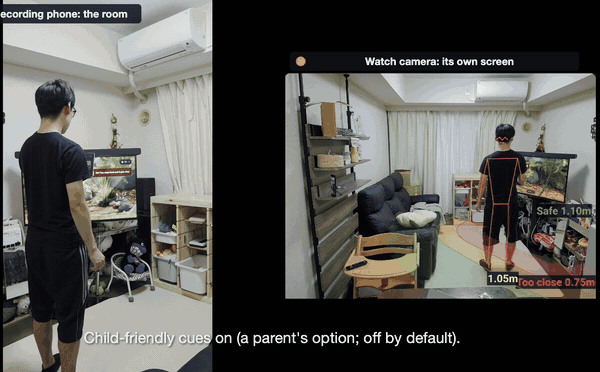
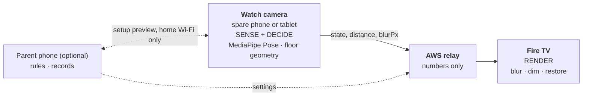
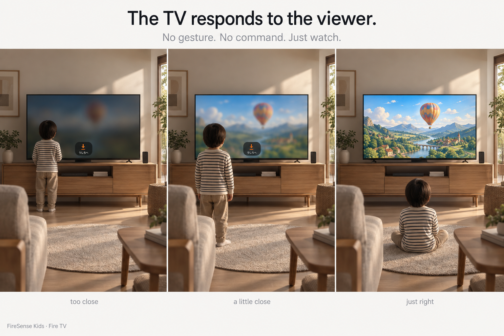
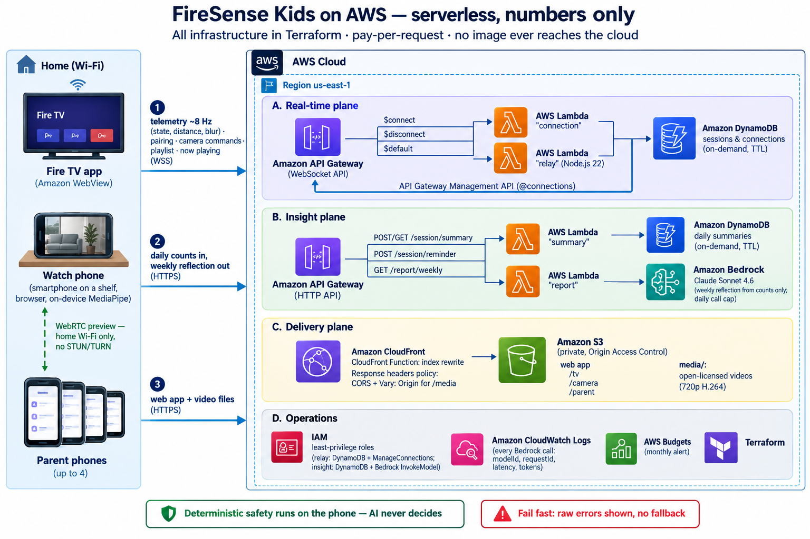
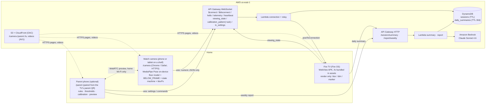

# 🐾 FireSense Kids — Body-Aware Viewing for Fire TV

> **A Fire TV experience that reacts to how close the viewer is.**
> **No gesture. No command. Just watch.**



*Uncut, on a real Fire TV Stick 4K Max (from the [demo video](https://youtu.be/-O-m-KmxTes)). Left: a phone recording the room. Right: the watch camera's own screen at the same moment, with the measured distance. The mascot card is a parent option, off by default.*

Built for the **Amazon Developer Hackathon 2026** — Track: **Fire TV** / Mini Challenges: **AWS Builder**, **Open Source**
([visual-thinker](https://github.com/marcosanyo/visual-thinker)).

**Demo video (under 3 min):** https://youtu.be/-O-m-KmxTes

日本語版: [README.ja.md](README.ja.md)

## Three ideas

**1. The TV responds to the viewer.** Walk toward the TV and the picture gets a little less clear; closer, it
blurs strongly and dims; step back and it restores by itself. Nothing to learn, nothing to press. The response is
proportional to where the child stands, not a warning that switches on at a line. There is deliberately no gesture
or voice command: the only thing that clears the picture is what the rule asks for, stepping back. A gesture would
give a child a way to clear it while staying close, and would have to be learned first.

**2. The TV itself becomes the ruler.** A Fire TV has no camera, so a spare phone or tablet on a shelf watches
the room. To calibrate, the TV paints its screen black, then magenta; the phone finds the screen's corners and,
because the screen size is known and the phone's gravity sensor gives its tilt angles, solves where it stands
and maps the floor in front of the TV. No floor markers, no camera-intrinsics database, no image upload. In a real
living room the median distance error is **10 cm** (0.8–1.4 m), and **3 cm** once a parent matches two points with a
tape measure (2 cm, max 8 cm, at the distances not used for the fit).

**3. Sense locally. Relay numbers. Render on TV.** The watch camera runs pose estimation and every decision on the
device. AWS relays numbers and keeps daily counts. The Fire TV only renders.



- **No child video leaves home.** Only numbers reach the cloud.
- **No AI in the real-time intervention loop.** Distance → blur → restore is deterministic; Claude on Bedrock only
  writes the parents' weekly reflection, from counts.
- **Sensor failure restores clear playback.** A broken or closed sensor never leaves the picture blurred.

**Validation.** The demo video shows the whole loop on a real Fire TV Stick 4K Max with an adult viewer, uncut,
on two devices at once. The distance numbers come from an adult standing on tape-measured marks, with the phone in the
far corner of the room; the measuring tools are built into the app ([`MEASUREMENT_EVIDENCE.md`](docs/proof/MEASUREMENT_EVIDENCE.md)).

**Small children.** On a real phone across the room, the default model (MediaPipe Pose) finds our 16-month-old:
the skeleton in the video's detection test is MediaPipe. It works best when the child faces the camera; turned away
or sideways, it loses them more often. Full-frame inference alone missed small children, so the watch camera adds a
zoomed second pass (4× tiles while nobody is found, then a crop that follows the person). For children who appear
small or far away, the optional **High accuracy** model (RTMO) finds more, on phones whose WebGPU works (numbers in
§3). The interaction is designed for preschool and early-school children, who can notice that walking up makes the
cartoon hard to see. A 16-month-old does not yet connect the picture with where they stand, so our child appears only
in the detection test, and the multi-day home study ([`FIELD_PILOT.md`](docs/proof/FIELD_PILOT.md)) is for that older
age group.

FireSense Kids explores this interaction for family viewing: a house rule the parent sets, which the TV is designed
to keep without repeated parental scolding. The parent decides how close is too close and how firmly the TV
responds. It makes no claims about eyesight or health.

---

## Try it in 5 minutes

**Judges:** our hosted TV screen (AWS us-east-1) is the Devpost **Project Testing Link**, and
`firesense-kids-judges.zip`, attached to the submission, has the APK and every hosted URL. **Everyone else:** deploy your own stack with `make deploy` (§8); the URLs below are its Terraform
outputs (`terraform -chdir=infra/terraform output -raw tv_url`, and so on).

### Without any hardware (a computer; a phone is optional)

1. **Open the TV screen** in a desktop browser (Chrome, Edge or Safari): the **`tv_url`** output,
   `https://<cloudfront_url>/tv/`. If the cartoon does not start, click anywhere on the page once (browsers may block autoplay).
2. **Pair.** Setup step 1/2 shows the watch camera's QR code (orange). Scan it with a phone, **or** click
   "Try on a PC: open this link in a new window" under the QR code and put the two windows side by side
   (a new *window*, not a tab: a TV tab in the background pauses its video). Step 2/2 offers a parent phone's QR
   code (indigo); "Later" skips it.
3. **Drive it with test mode.** On the phone page (`/camera`), open "Development and validation" → "Test mode", tick
   "Send test input", and move the distance slider. No camera is used; synthetic distances go through
   the real AWS relay.
   - from **1.65 m** down → the picture starts to blur, a little at first, and a small line-drawing marker appears at the bottom
   - below **1.30 m** → strong blur and dimming
   - back past **1.65 m** → the picture is clear again, on its own
   - "Feet left the bottom (BELOW_FRAME)" → full blur, as when a child walks under the camera's view
4. **Pull the plug.** Close the phone window. Within 3 s the blur clears and the TV shows
   "Sensor not connected" — a broken sensor never leaves the child's picture blurred.

**Language.** The UI is in English. Japanese is available per device: the EN | 日本語 switch on the phone
pages, a button in the TV's OK menu, or `?lang=ja` in any URL. The parents' weekly reflection is written in the
parent phone's language.

The TV labels test input "Test input" and never records it. **Optional rules** are set from a parent phone
(on the TV press OK → "Add a parent phone"): child-friendly cues (a mascot card, a voice line and a star when
the child steps back; off by default) and pausing the video after sustained too-close viewing (off by default).
The same flow works on the framework-free player at the **`example_player_url`** output (see *Integrate FireSense
into your player* below).

### With a Fire OS device (Fire TV Stick 4K Max 2nd gen, Fire TV Cube, …; not Vega OS)

1. Settings → My Fire TV → Developer options → **ADB debugging ON**; note the device's IP address.
2. Get the APK: judges use `firesense-kids.apk` from the file attached to the Devpost submission (it connects to
   our hosted stack); otherwise `make deploy` builds one for your own stack at
   `firetv-app/app/build/outputs/apk/debug/app-debug.apk`. Then:

   ```bash
   adb connect <fire-tv-ip>:5555
   adb install -r firesense-kids.apk
   ```

3. Open **FireSense Kids** from the Fire TV home screen, scan the QR code with a phone, and continue from
   step 3 above (or tap "Start watching" and calibrate to use the real camera).

Each installation gets its own random session; no account is needed. The hosted stack limits abuse with
API Gateway throttling and a per-session daily cap on Claude calls (HTTP 429 `RATE_LIMITED`, shown as-is).

## Integrate FireSense into your player

`/tv` is the reference player. Any player gets FireSense from one class, `FireSenseViewer`
([`lib/firesense/viewer.ts`](lib/firesense/viewer.ts), plain TypeScript, no React): blur your video by
`frame.blurPx`, show your own reward on `event`, draw the pairing QR from `pairing.pairingUrl`, and report
play/pause. The engine keeps the promises for you: no blur while the sensor is down, none in record-only mode.

- **[`docs/PROTOCOL.md`](docs/PROTOCOL.md)** — the 15-line minimal integration (type-checked), the player's
  promises, and every message.
- **[`examples/plain-video-player/`](examples/plain-video-player/)** — a second, framework-free player
  (one `<video>`, a sensor badge, stars, a QR panel). Its FireSense integration is **24 lines**, counted as the
  non-blank, non-comment lines between `// firesense:begin` and `// firesense:end` in
  [`main.ts`](examples/plain-video-player/main.ts) (`node scripts/count-integration-lines.mjs`; a test keeps this
  number in sync). The rest of the page is the player's own UI (`ui.ts`, `style.css`). It is built with esbuild
  into `public/examples/plain-video-player/` by `npm run dev` / `npm run build`, so after `make deploy` it is served
  at `<cloudfront_url>/examples/plain-video-player/`. Add `?src=<video URL>` to play your own video.

## 1. What it does

Viewers drift toward the TV, children especially. Instead of a parent repeating "back up!", the viewing experience
itself responds:

```text
safe (≥ 1.65 m)          → clear
approaching              → a light blur, growing with every step; a small marker at the bottom
too close (< 1.30 m)     → strong blur and dimming
feet under the camera    → full blur (BELOW_FRAME)
step back                → restores automatically, in proportion
sensor lost              → clear picture and a calm "Sensor not connected" badge
```



On the wire the phone sends `blurPx`: 0 beyond SAFE, a light 1–4 between the lines, 16–24 past TOO_CLOSE (24 from 0.3 m inside it). The reference player renders
it at twice that radius and dims and desaturates the picture toward 60 % as it grows
([`lib/client/tv-visuals.ts`](lib/client/tv-visuals.ts)), so too close means "only outlines left", while one step
back already brings the picture partly back.

**The parent sets the rule; the TV keeps it.** From the parent phone ("How the TV responds"):

| Setting | Default | What it does |
|---|---|---|
| Thresholds | TOO_CLOSE 1.30 m / SAFE 1.65 m | where the blur starts and where it is strongest |
| Small marker | **on** | a quiet line drawing (floor band and an arrow) at the bottom center while approaching or too close; no character, no sound |
| Child-friendly cues | **off** | the mascot card and voice when too close, "Nice step!" on the first step back, a star and praise back at a safe distance, and the posture voice nudge. Off by default so the TV does not become something a child approaches to trigger |
| Pause after sustained too-close viewing | **off** | a stronger rule some families may want: after 10–60 s (20 s once enabled) of TOO_CLOSE / BELOW_FRAME the video pauses quietly, and resumes 2 s after the child steps back |
| Record only | off | shadow mode: no response at all, only counts (the baseline of the designed home study) |

## 2. Architecture


### 2.1 Responsibilities

| | Watch camera | AWS | Fire TV | Parent phone (optional) |
|---|---|---|---|---|
| Role | **Sense + decide** | **Relay + records** | **Render** | **Rules + records** |
| Runs | `/camera` in the phone browser: MediaPipe Pose, TV-marker floor geometry, BELOW_FRAME, state machine, `blurPx` | API Gateway WebSocket relay, daily counts, weekly reflection | WebView APK with `/tv` bundled: blur, dim, marker, playlist | `/parent`: thresholds, rules, calibration, videos, records |
| Sees video | yes, stays on the device | never | never | only a setup preview, directly over home Wi-Fi |

- **Only one extra device is required**: a spare phone or tablet that stays on a shelf as the watch camera. The
  parent phone (paired from a second QR on the TV, up to 4) is a convenience: it changes the installed camera's
  mode, thresholds and calibration through the relay without touching it, picks the videos, shows the records, and
  can black out the camera's screen while sensing continues. Without it the TV plays its default playlist with the
  defaults above.
- **The real-time intervention loop is deterministic, on the phone.** AWS relays numbers and records daily counts;
  the LLM never takes part in blur, dimming or pausing.
- **No image ever reaches the cloud** — not the child's video, not a setup photo. The setup preview uses WebRTC with
  no ICE servers, so there is no path through a server.
- **Why the relay goes through AWS inside one home.** Browsers open the camera (`getUserMedia()`) only on a secure
  page (HTTPS or localhost), so a page served from a box at home (`http://192.168.x.x`) cannot use the phone's camera
  without a certificate the phone trusts (Friction Log entry 2). Serving `/camera` from CloudFront over HTTPS and
  relaying small numeric JSON (about 8 per second while someone is near the lines) through API Gateway WebSocket lets
  a family pair with one QR scan and no network setup; the TV runs no local server, and the same relay keeps the daily
  counts. The trade-off is that it needs an internet connection. Either way the video stays on the phone.

### 2.2 AWS implementation





Bedrock sits deliberately outside the real-time loop: it reads daily counts and writes a weekly reflection for the
parents, nothing else (§6).

**Wire protocol v1** (`lib/firesense/protocol.ts`, zod, shared by phone / TV / Lambda):
`telemetry { seq, state, distanceM|null, blurPx, posture, confidence, floor?, event?, test? }`, `heartbeat { fps }` (1 Hz, always), `viewing_state { playing }`, `calibration_pattern { magenta|black|off }` (phone → TV) and `calibration_pattern_ack` (TV → phone, after the pattern is painted), `tv_settings`, `peer_status`, plus the pairing messages. Details: [`docs/PROTOCOL.md`](docs/PROTOCOL.md).

### 2.3 Three things we learned on real devices

Chosen from the [Friction Log](docs/proof/FRICTION_LOG.md) and the build notes because each one changed the design:

1. **Pure corner geometry was not enough in a real living room → the gravity sensor anchors it.** Solving lens and
   pose from the screen's four corners is exact on paper, but when the TV fills only about a fifth of the frame a
   1–2 px corner error moved the 1 m point by 0.25–0.6 m. Fixing the camera's tilt angles (pitch and roll) from the phone's accelerometer and using the
   lens height leaves only 4–5 unknowns for 8 corner coordinates: under the same ±2 px noise the error dropped from
   0.64 m to 0.09 m (synthetic, 40 runs, `tests/zone-adjust.test.ts`).
2. **Amazon WebView plays `<video>` in a hardware overlay → nothing to blur** (Friction Log entry 12). On a real Fire
   TV the picture was black with sound, and CSS filters could not touch it. A hidden holder video now owns the one
   overlay per page, so the visible video is drawn into the page and can be blurred.
3. **Hardware-decoded frames drawn into the page showed green stripes → every video is AV1** (entry 13). No
   screenshot captured it; the per-video decoder (CDP `Media` domain) showed AV1 is decoded in software there.

## 3. Sensing

| Piece | File | What it does |
|---|---|---|
| Floor model | `lib/firesense/floor-calibration.ts` | Distance comes from where the **feet touch the floor**, never from body size, so it is independent of the child's height. Two model kinds: `1/d = a·y + b` (phone facing the room from the TV) and a **floor homography** `Z = (p·[x,y,1]) / (q·[x,y,1])`, exact for any placement including a phone beside or diagonal to the TV. Red (TOO_CLOSE) and green (SAFE) lines are drawn on the floor in the camera view. |
| **TV-marker calibration** (the one calibration households use) | `lib/firesense/tv-marker.ts`, `lib/client/gravity.ts` | The Fire TV itself is the ruler: marker-based AR with the TV screen as the marker. The solved camera pose pins the red and green zones to the real floor in the camera view and turns the feet's floor position into a distance. The phone asks the TV (over the relay) to paint its screen black, then magenta. Screen detection: difference × magenta hue → largest component → maximum-area quad on the convex hull → sub-pixel side refit (the ½-crossing of the difference, PCA lines) → corners. The screen is a rectangle of known size (from its inches). **Gravity anchor** (`solveTvPoseGravity`): 2.5 s of accelerometer readings fix the camera's pitch and roll, the lens height is entered, and only yaw, position, focal length (and, with the optional screen-bottom height, a TV-size factor) are fitted to the 8 corner coordinates (Levenberg–Marquardt); ±2 px corner noise moves the 1 m point by 0.09 m instead of 0.64 m. When the corners and gravity disagree (> 6 px per 1000 px) it stops with the numbers. On a phone without a usable motion sensor it solves from the corners alone (homography `H = K[r1 r2 t]`) and says in the result and on screen that accuracy is lower. Inputs: TV size and lens height; optionally the screen-bottom height and one or two tape-measured points to fine-tune. After calibration, a tilt change of 3° for 2 s, or a rotated or resized frame, stops the distances until the parent recalibrates or confirms. |
| Other calibrations (development and tests) | `/camera` → "Other methods" | Tapping three floor lines, standing on two marks (A/B), or height/tilt/FOV (approximate, labeled). Kept for the debug scenes and tests; households use the TV marker. |
| **Watch zone** | `lib/firesense/coverage.ts` | After calibration the floor in front of the TV is shaded on the camera view (red: too close, amber: approaching, green: safe). With the TV-marker pose the real zone (screen width ± 0.5m, 0.3m to SAFE + 0.8m) is projected, and the phone reports how much of it — and of the too-close band in particular — is in view, which way to turn the phone if part is missing, and the distance resolution at the TOO_CLOSE line (cm per pixel). Deterministic; no AI. |
| Adjustable thresholds | parent phone or `/camera` sliders | TOO_CLOSE / SAFE (defaults 1.30m / 1.65m). `blurPx`: between the lines (APPROACHING) a light hint, 0 → 4; past TOO_CLOSE a clear jump to 16, then 24 at 0.3m inside it (`lib/firesense/blur-policy.ts`); the reference player renders it at 2× with dimming (§1). SAFE is kept ≥ TOO_CLOSE + 0.1m. |
| **BELOW_FRAME** | `lib/firesense/below-frame.ts` | (Phone in front of the TV.) Near the TV the feet leave the bottom edge of the frame (closer than `d_edge = 1/(a+b)`). If the feet were last seen near the bottom of the visible floor (adjustable when a TV-stand top hides the lowest part), are now gone, and shoulders + hips are visible → **max blur, latched**. Released when the feet reappear, or after 30s with nobody detected. Knee/height guesses are not used. With the phone at the side of the room, the bottom edge is the floor in front of the phone, so BELOW_FRAME additionally requires the last distance to be inside TOO_CLOSE. |
| State machine | `lib/firesense/state-machine.ts` | `SAFE / APPROACHING / TOO_CLOSE / BELOW_FRAME / LOW_CONFIDENCE`, 5cm hysteresis, low-confidence hold ≤ 5s. Events for the optional child cues and for the records: `WARN`, `PHASE1_RECOVERY` (first step back), `STAR_AWARDED` (SAFE held 2s after a warning, 15s cooldown). Posture is ambient only (never blurs). |
| Adaptive frame rate | `lib/firesense/frame-rate.ts` | 2 fps idle, **8 fps** when `d < SAFE + 0.35m`, `|Δd| > 0.15m`, or not SAFE; back to 2 fps after 3s calm; 0 fps while the TV is paused. Keeps the phone cool and still tracks a running child through the bottom edge. |
| Posture | `lib/firesense/posture.ts` | Torso lean and ear-over-shoulder head tilt from metric world landmarks (angles shown on `/camera`). After 4s of slouching while SAFE — or while the feet are hidden (sitting) if the last trusted state was SAFE — the TV says "Let's sit up tall" (30s cooldown). Never blurs. |
| Records: period, comparison, reset | `components/records-range.tsx`, `components/floor-heatmap.tsx`, `GET /session/summary?from=&to=`, `POST /session/summary/reset` | The parent phone shows any period of whole days within the last 30 (records are daily, in DynamoDB, 30-day TTL) and can put a second period's floor heatmap next to it. "Reset all records" goes parent → relay → TV (`tv_records_reset`): the TV clears its running counters for today, deletes every stored day of its session, and uploads an empty day, so its next upload cannot bring the old numbers back; it works only while the TV is connected, and the parent checks that the days are gone. |
| Zoom area (drawn) | `lib/firesense/zoom-roi.ts` (`manualZoomRoi`), parent phone preview | The parent drags a box on the live video; the zoomed second pass (4× tiles, then a crop that follows the person) searches that box instead of the computed watch zone, e.g. when the computed zone fills the view. The full-frame pass still runs every frame. The 4× tiles are scanned only while nobody is found; once someone is found, the crop follows that person every frame (scanning while someone was found made the target jump between two people). People cut off by a crop's edge are ignored there (a cut-off body invented feet at the edge). On the user's 4 real frames (low-resolution screenshots): children 0/4 → 1–2/4. |
| Seated viewer | `lib/firesense/hip-ground.ts` (`isSeated`, `estimateSeatedViewpoint`) | MediaPipe + TV marker: both thighs > ~55° from vertical in the room → the distance is taken under the head, not at the feet (feet on a sofa's footrest read about 1 m too close). Hip height: the drop to the feet when the shins are vertical, else fitted from the upper body's size; then the head's offset from the hips (3D landmarks). Labelled "seated" on the camera view. |
| Setup lock | `components/camera-remote.tsx`, `app/camera/page.tsx` | Once calibrated, the calibration, distance lines, watch zone and zoom area fold away and lock, on the watch camera and on the parent phone. "Change setup" opens them, "Done" locks them again, so a scroll that starts on a slider cannot move a line. |
| Skeleton only | `/camera`, parent phone (`set_skeleton_only`) | Hides the camera image on the watch camera and in the parent's preview while sensing continues; only the skeleton and the lines are drawn (e.g. to film a child without their image). |
| Pose model (choice) | `lib/client/pose-estimator.ts`, `lib/firesense/rtmo.ts` | **MediaPipe Pose Full** (default; 33 landmarks + 3D, zoomed second pass) or **RTMO-s / m / l** (ONNX Runtime Web on WebGPU, WASM as an explicit retry; COCO-17 mapped to the MediaPipe layout, heels estimated from the shin; no 3D, so no posture; with the feet hidden, a hip height learned while that person's feet were visible is used for up to 4 s, and dropped when the torso measured at the estimate changes by more than 12 %, which is what sitting down does (`HipMemory`, `lib/firesense/hip-ground.ts`)). On generated scenes this rejected sitting on the floor in 91–100 % of assumed camera setups, but sitting on a chair in only 67 %: with the feet hidden, a seated person can be read as standing, off by about 0.3 m. The choice is shown up front as **Standard** (MediaPipe: light, posture, sitting, hidden feet) or **High accuracy** (RTMO: also people who appear small or far away; heavy). Chosen on the watch camera or from the parent phone; never switched automatically. The skeleton, face included, is drawn on the video so a parent can see whether the person is really found. Models are uploaded to our CloudFront by `make upload-models` (pinned SHA-256); the ORT runtime is self-hosted under `/ort`. Measured in headless Chrome on a Mac (WebGPU): RTMO-s 48 ms, RTMO-m 59 ms, MediaPipe 35 ms per frame. |
| MediaPipe | `public/mediapipe/` | Models committed, WASM copied from `node_modules` at build (`scripts/sync-mediapipe.mjs`). No CDN. The GPU/CPU delegate is shown on screen; CPU is an explicit retry, not a silent switch. |

**Small children: what we measured.** Full-frame MediaPipe Pose found the child in 0 of 4 frames from a family's
living room (low-resolution screenshots of the parent phone); with the zoomed second pass, 1–2 of 4.
RTMO found the child in all 4 offline, through the same code the phone runs
(`tests/rtmo-live.test.ts`). On 14 generated living-room scenes (16 people, 13 of them children) MediaPipe found 7 and
RTMO-s/m/l all 16, with no false detections (`scripts/pose-bench/eval_nb.py`). At the distance of our own phone
frames (a child about 10–25 % of the frame high) on 13 more generated scenes, MediaPipe with the zoomed scan found 8 of
16 people and RTMO 14 of 16, with no false detections on people-free rooms for RTMO-m. RTMO depends on the
device's WebGPU: RTMO-s found people on a Galaxy S26 and an iPad mini 7, but on a Galaxy S20 the GPU returned wrong
scores (a built-in self-test stops it with the reason). It is heavy, so MediaPipe stays the default. On
the phone, the toddler in the video was tracked by MediaPipe, best when facing the camera (an observation, not a
benchmark).

## 4. When the relay drops

The TV treats the sensor as disconnected on socket close/error, `peer_status camera=false`, **3s without telemetry or heartbeat**, or at once when the phone says it is leaving (`camera_leaving`: the watch page went to the background or is being closed). The blur then clears over 500ms, an automatic pause (if a parent turned it on) is released after 5 s, optional child cues stop, and a calm **"Sensor not connected"** badge stays on screen with the reason under it (e.g. "The watch camera page was closed"). When the TV cannot know why (3 s of silence), the badge says so: "Reason unknown". Reconnect uses 1→2→4…30s backoff to the same endpoint, and the badge clears on the first fresh telemetry. Disconnect count and duration go into the daily summary.

**Coming back.** A watch phone that returns from the background (another app, a closed cover) stops its camera while hidden and, when visible again, restarts it and reconnects to the relay at once if it was away more than 3 s; a camera track that ends by itself is restarted too. The TV app reconnects when Fire OS resumes it. Nobody rescans a QR code or reloads a page.

## 5. QR pairing (one TV ↔ one watch phone, per installation)

- **Identity.** On first launch each Fire TV installation creates its own session: a random 128-bit `sessionId` and a `tvSecret`, kept in the app's SharedPreferences (`window.FiresenseNative` bridge). It deliberately does **not** use a hardware or advertising ID. Every TV is therefore an independent tenant; a household with two TVs gets two sessions, each with its own phone and its own daily records. Uninstalling the app (or clearing its data) forgets the session.
- **Pairing.** The TV shows a QR with a one-time, 5-minute token. The phone's normal camera opens `/camera/?s=…&t=…`; the relay consumes the token atomically (DynamoDB conditional update) and issues a `cameraSecret` to that phone. Only hashes are stored. Unpaired connections cannot inject telemetry, and a TV only ever receives messages for its own session.
- **Setup steps, then a menu.** On first run the TV shows step 1/2, the watch camera's QR (orange), and after it pairs, step 2/2, a parent phone's QR (indigo, "Later" to skip; skipped when one is already added). Afterwards OK opens a menu with both devices' state, and each QR screen is one device in its role's color. A phone that scans the other role's QR is asked before it pairs.
- **Lifetime.** Both sides reconnect later without rescanning. The session lives 30 days and is extended on every TV connection. From the menu, the watch camera can be paired again; its QR screen can revoke the current phone (a new phone then pairs with a fresh token).
- **Judges need no deployment.** The APK attached to the Devpost submission carries the endpoints of our hosted AWS stack, and its QR points to the hosted `/camera` page; each installation gets its own isolated session. Everyone else builds an APK for their own stack with `make deploy` (§8). (Fire TV devices on Vega OS cannot sideload APKs.)

## 6. AI (Insight Plane): Claude Sonnet 4.6 on Amazon Bedrock

The single model is `us.anthropic.claude-sonnet-4-6` (US cross-region inference profile, IAM-scoped to it):
- **Weekly reflection** (`GET /report/weekly`): the last 7 daily summaries (counts only) become a short parent reflection and mascot line suggestions. With no data, Claude is not called and the page says "No records yet".

AI is deliberately **not** used for setup. Earlier versions had a photo-based setup check and AI tape selection; both were removed once TV-marker calibration and the watch zone gave exact, deterministic answers (see `docs/proof/FRICTION_LOG.md` entry 11). As a result no image is ever sent to the cloud.

Every response carries `modelId / requestId / latencyMs / inputTokens / outputTokens`, also logged to CloudWatch. Errors fail fast: raw status and message are shown in the UI. There is no mock and no alternate model (`docs/NO_FALLBACK_POLICY.md`).

## 7. Repository

```text
app/camera  app/tv  app/parent     Next.js pages (static export)
lib/firesense/                      sensing core + protocol + transport (shared)
lib/client/                         browser helpers (endpoints, API, storage bridge)
infra/lambda/                       4 Lambda handlers (esbuild → Node.js 22)
infra/terraform/                    DynamoDB, Lambda, API GW (WS + HTTP), S3 + CloudFront, IAM
firetv-app/                         Fire TV WebView APK (Kotlin)
tests/                              vitest (unit + Lambda core + live Bedrock)
docs/                               plan, proof, reference
```

## 8. Build, deploy, install

Everything runs in Docker (the host needs only Docker; AWS credentials in `.env`, see `.env.example`).

```bash
make test          # vitest + tsc
make tf-validate   # bundle Lambdas + terraform validate
make deploy        # Lambda build → terraform apply → static export with real endpoints
                   # → S3 sync + CloudFront invalidation → TV assets → APK
```

`make deploy` needs two values with no defaults, set in `.env` (see `.env.example`): `TF_VAR_monthly_budget_usd` and
`TF_VAR_budget_alert_email` (an AWS Budgets alert at 80% of actual and 100% of forecast monthly cost). The
per-session daily cap on Bedrock calls is `TF_VAR_report_daily_limit` (default 30). `make deploy` also uploads
`/tv`, the sample video and `examples/` to CloudFront for the browser trial; the APK keeps its own copy.

`TF_AUTO_APPROVE=1 make deploy` skips the Terraform prompt; `SKIP_INSTALL=1` skips installing the APK. `make emu-start` / `make emu-stop` start and stop the Fire TV emulator (cold boot, so its clock is correct).

`next build` fails on purpose unless `NEXT_PUBLIC_WS_URL`, `NEXT_PUBLIC_API_URL` and `NEXT_PUBLIC_WEB_ORIGIN` are set. `scripts/deploy.sh` takes them from `terraform output`.

**Sideload to Fire TV** (Settings → My Fire TV → Developer options → ADB debugging ON):

```bash
adb connect <fire-tv-ip>:5555
adb install -r firetv-app/app/build/outputs/apk/debug/app-debug.apk
```

The app appears on the Fire TV home screen as **FireSense Kids**. On first launch the TV shows a QR code: scan it with the watch phone, tap "Start watching", then calibrate. Recommended: place the phone where it sees both the TV screen and the floor in front of it, enter the TV size and the phone height, and press "Calibrate on the TV".

**Debug sources on `/camera`.** Besides the front and back camera, "Debug image" runs MediaPipe continuously on fixed generated images (two rooms: phone in front of the TV, and the TV-marker scene with black/magenta screen frames plus sitting upright / slouching / lying for posture), each with a one-button calibration. Test mode sends synthetic distances, BELOW_FRAME, lost tracking and slouching through the real relay; the TV labels it "Test input" and does not record it.

Remote: **OK** = show the pairing QR (and, from there, "Measurement menu": render benchmark — blur 0/12/24px × full/downscale, about 45 s, MEASUREMENT_EVIDENCE §5 — and relay round trip, 20 probes, §3) · **Back** = close / exit confirmation · **Play/Pause** = playback · **⏩ / ⏪** = 10 s forward / back · **◀ / ▶** (and ⏮ / ⏭) = previous / next video · **Menu** = debug overlay (relay state, camera fps, render/video fps, blur mode). Each sensor drop is also timed until the blur is gone (§6). Results stay on the TV and go to logcat as `[firesense-measure]` lines.

**What the TV plays.** A parent phone picks a preset or pastes its own list of https video URLs (one per line, the host must allow CORS); the TV plays the list in order and repeats it, remembers it, shows the title and credit of each item, and reports what is playing (and the raw error if an item fails) back to the parent phones. Presets are open-licensed films hosted on our CloudFront (`make upload-media` fetches them from download.blender.org, checks their SHA-256 and transcodes them to 720p). Streaming services such as YouTube are refused: covering their player with our blur would break their terms.

## 9. Tests

```bash
make test
```

| Suite | Covers |
|---|---|
| `below-frame.test.ts` | `d_edge`; no knee substitution; bottom exit vs. sideways exit vs. occlusion; latch release rules; running child at 8 fps; distance gate for side placement |
| `state-machine.test.ts` | blur ramp; two-phase recovery; star dwell and cooldown; BELOW_FRAME; LOW_CONFIDENCE hold; posture never blurs; adaptive fps |
| `transport.test.ts` | protocol validation; backoff; seq gate; disconnect detection (close / camera_leaving / peer_status / 3s silence); reconnect + hello |
| `floor-calibration.test.ts` | 2-point fit, IQR, geometric inversion guard, height/tilt/FOV model |
| `floor-homography.test.ts` | floor homography on a synthetic side camera (< 1cm), wrong line order detected, iso-distance lines |
| `coverage.test.ts` | floor-point projection from the TV-marker pose (matches the true camera), coverage and turn hints, distance-only models |
| `tv-marker.test.ts` | self-calibrated focal length and pose (exact), floor distance < 1cm, corner noise, sub-pixel screen detection on rendered frames, generated debug scene |
| `posture.test.ts` | upright adult is GOOD (ear-based), text neck and torso lean are SLOUCH |
| `lambda-relay.test.ts` | QR token one-time / expiry / mismatch; resume; pairing reset; relay; calibration pattern, camera_leaving and rtt_ping/pong routing and roles; unpaired drop; GoneException → peer_status; disconnect |
| `lambda-insight.test.ts` | auth; summaries (per-mode, old records read as missing); parent reminders ±1; weekly report (no data → no LLM call); malformed model output and health/eyesight wording fail fast; per-session daily cap → 429 `RATE_LIMITED` |
| `viewer.test.ts` | `FireSenseViewer`: frames, disconnects clear blur, seq order, pairing, calibration ack, shadow mode draws no blur, camera_leaving reason, linkLost timing, rtt_ping/pong round trip |
| `daily-stats.test.ts` / `pilot-metrics.test.ts` | field-pilot counters (warn seconds, WARN→SAFE times, 200 cap) and the CSV export |
| `protocol-doc.test.ts` / `example-integration.test.ts` | `docs/PROTOCOL.md` quotes the type-checked snippet; README's integration line count is current |
| `distance-accuracy.test.ts` | the measurement report: missing frames are never error 0, median / p90 headline per calibration method, CSV round trip |
| `tv-bench.test.ts` | render benchmark steps (0/12/24px × full/downscale), per-second rates, unavailable values stay empty in the CSV |
| `bedrock-live.test.ts` | real Claude Sonnet 4.6 call on Bedrock for the weekly report (runs when AWS credentials are present) |

Measured performance numbers are published only after measurement: see [`docs/proof/MEASUREMENT_EVIDENCE.md`](docs/proof/MEASUREMENT_EVIDENCE.md) for the protocol. Distance accuracy is recorded on the watch phone (`/camera` → "Measure distance accuracy (validation)", raw frames saved as CSV) and tabulated with `node scripts/distance-accuracy-report.mjs <csv>`.

## 10. Beyond the reference implementation

**Today: a Fire TV reference implementation. Future: body-aware viewing as a platform capability.**
Fire TV does not allow overlays on other apps, so FireSense does not claim to work on top of Prime Video or any
other app today. What it shows is that the body-aware layer is small and separable: `FireSenseViewer` is one
class, and a second, framework-free player embeds it in 24 lines. The sensor is replaceable too: anything that
yields the same `telemetry` messages works, such as a network camera or a TV-side camera. A future step is in-home
direct transport (WebRTC).

Two ways it could reach families: a Fire TV Appstore app in the form shown here (a player for the videos the
parent picks, with a spare phone as the sensor), or inside an existing children's player through `FireSenseViewer`.
Either way, the next step is the multi-day home study ([`FIELD_PILOT.md`](docs/proof/FIELD_PILOT.md)).

## License

MIT, see [LICENSE](LICENSE).

## Video credits

- *Big Buck Bunny* © 2008 Blender Foundation, [peach.blender.org](https://peach.blender.org/), [CC BY 3.0](https://creativecommons.org/licenses/by/3.0/). The 1-minute clip bundled in the TV app (`public/videos/cartoon*.mp4`) is an excerpt.
- *Caminandes: Llama Drama* (2013), *Caminandes 2: Gran Dillama* (2013), *Caminandes 3: Llamigos* (2016) © Blender Foundation, [caminandes.com](https://www.caminandes.com/), [CC BY 3.0](https://creativecommons.org/licenses/by/3.0/).
- *Spring* (2019) © Blender Foundation, [CC BY 4.0](https://creativecommons.org/licenses/by/4.0/).
- *WING IT!* (2023), *Coffee Run* (2020), *The Daily Dweebs* (2017) © Blender Foundation, [studio.blender.org](https://studio.blender.org/), [CC BY 4.0](https://creativecommons.org/licenses/by/4.0/).
- *To Spring* (1936), public domain (via [Wikimedia Commons](https://commons.wikimedia.org/wiki/File:To_Spring_(1936).webm)).
- *Gulliver's Travels* (1939, Fleischer Studios), public domain (via [Wikimedia Commons](https://commons.wikimedia.org/wiki/File:Gulliver%27s_Travels_(1939).webm)).

All are transcoded to AV1 (720p at most) for streaming — on a real Fire TV, hardware-decoded H.264/VP9 drawn into the page showed green stripes, while AV1 is decoded in software; nothing else is changed.
